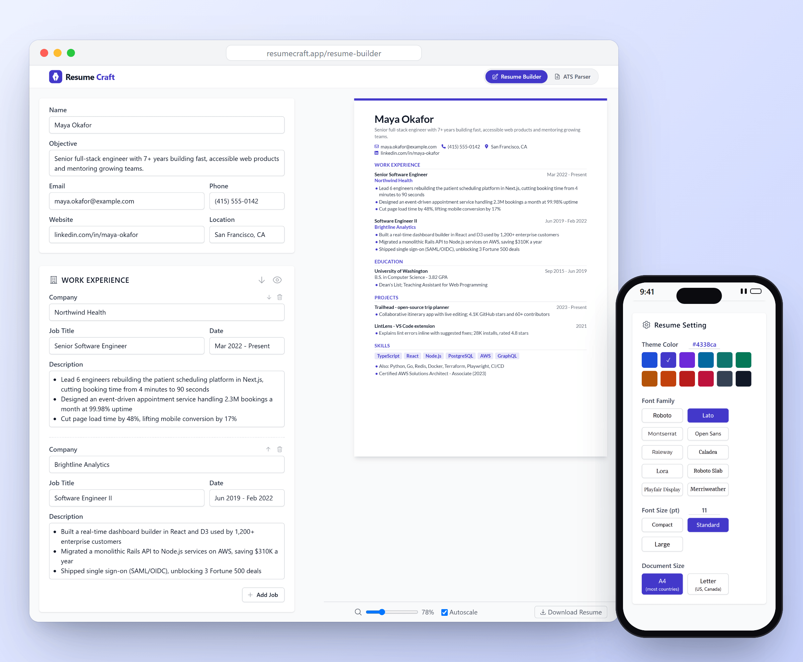
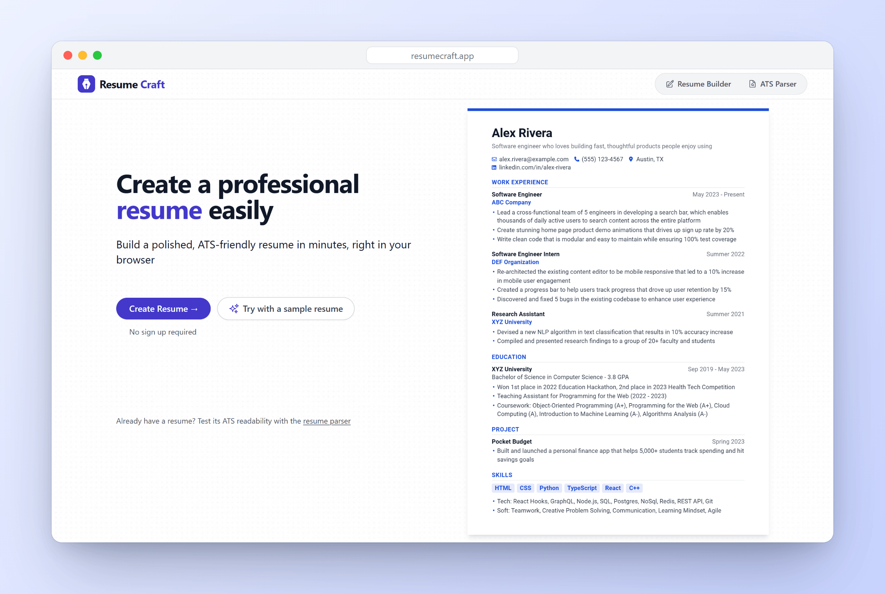
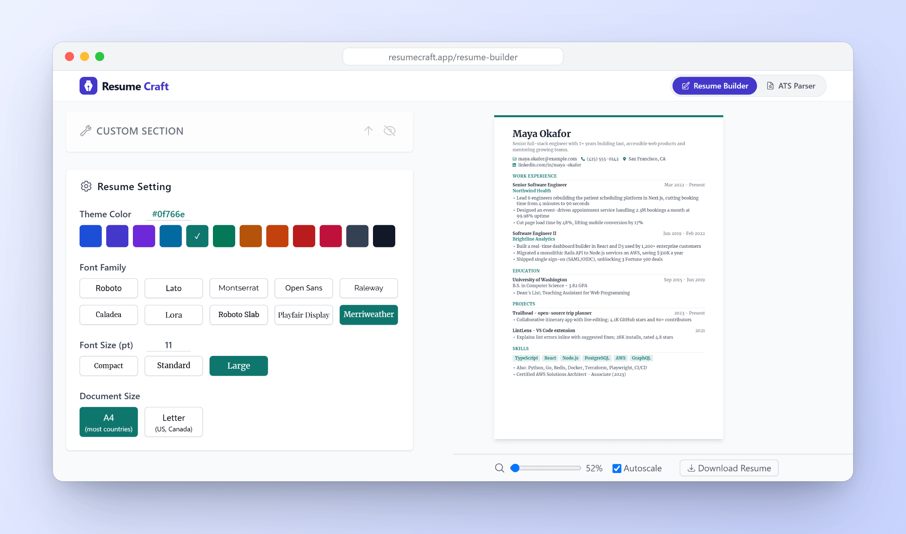
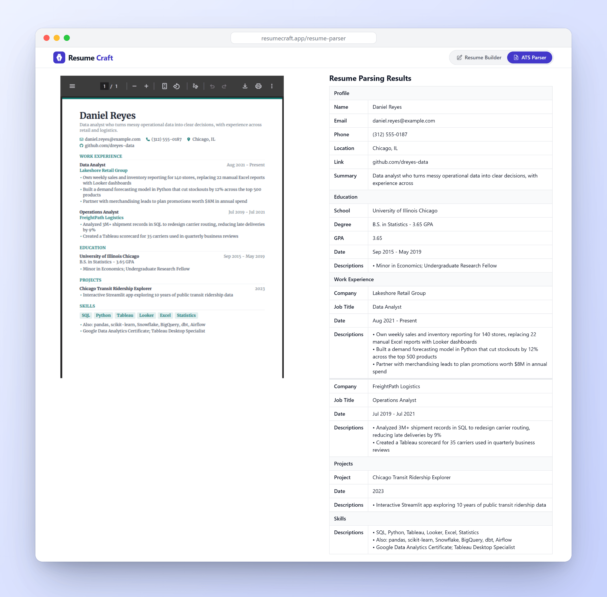
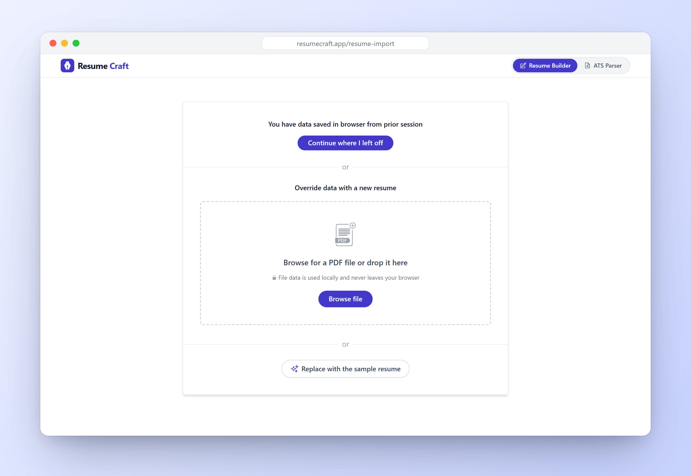
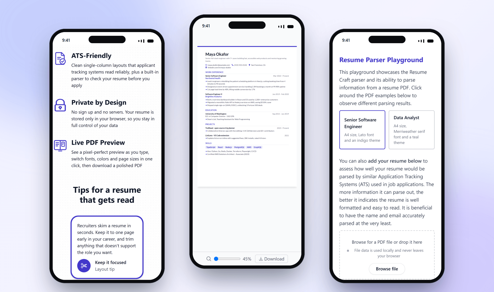
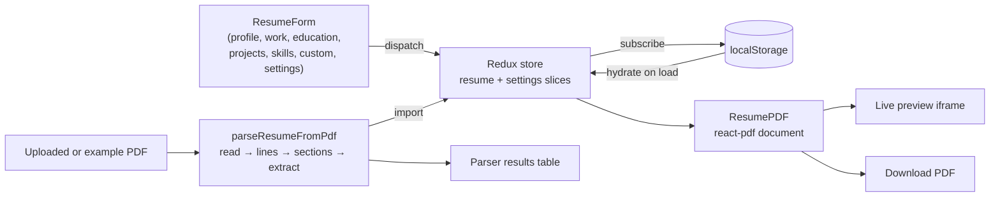

<div align="center">

# Resume Craft

**A free, private resume builder and ATS parser that runs entirely in your browser: type on the left, watch a polished PDF update on the right, then check how an applicant tracking system will read it.**


[Features](#features) · [Design](#design) · [Screenshots](#screenshots) · [Tech stack](#tech-stack) · [Getting started](#getting-started)

</div>

<br>

<p align="center"></p>

## Overview

Resume Craft has two tools:

- **Resume Builder.** A structured form (profile, work experience, education, projects, skills and a custom section) next to a live preview of the PDF. Pick the theme colour, font, font size and page size, reorder or hide sections, and download the result as a PDF.
- **ATS Parser.** Drop in any resume PDF and see the fields a tracking system would extract: name, email, phone, location, jobs, schools, projects and skills. It shows how readable a resume is before you send it.

There is no sign-up and no server. Everything is kept in `localStorage`, PDFs are read and written in the browser, and the app still works offline once it has loaded.

## Try the demo

Run it locally (see [Getting started](#getting-started)) and click **Try with a sample resume** on the home page. The builder opens with a complete example resume you can edit. On the **ATS Parser** tab, pick one of the two example PDFs to see the parser's output without uploading anything.

## Features

### A live preview that keeps up with your typing

Every keystroke updates the resume on the right, with zoom controls and an autoscale that fits the page to your screen. Sections can be reordered, hidden or renamed, bullet points switched on or off per section, and up to 12 featured skills shown as tags. Your work is saved on every change, so a reload never loses anything.

<p align="center"></p>

### One-click styling

Twelve accent colours (all deep 600 to 800 shades, so headings stay readable and print well in grayscale), ten font families in sans and serif, compact, standard or large text, and A4 or US Letter pages. Every change reflows the resume instantly.

<p align="center"></p>

### An ATS parser you can check yourself against

The parser reads a PDF with PDF.js, groups text into lines and sections, then scores every candidate line for each field. The results table sits next to the PDF, so you can see exactly what a tracking system would pick up and what it would miss. Two example resumes (an engineer in Lato and indigo, an analyst in Merriweather and teal) show it working without an upload.

<p align="center"></p>

### Start from your existing resume

Import a PDF to fill the form automatically, continue where you left off, or replace everything with the sample resume. Empty, invalid and upper-case `.PDF` files get clear error messages.

<p align="center"></p>

<details>
<summary><b>Full feature list</b></summary>

**Builder**
- The preview re-renders as you type, with zoom controls and an autoscale option.
- 12 theme colours, 10 font families (sans and serif), compact/standard/large text and A4 or US Letter pages.
- Sections can be reordered, hidden or renamed, and bullet points can be turned on or off for each section.
- Up to 12 featured skills, shown as tags at the top of the skills section.
- Single-column, text-based PDFs that tracking systems parse reliably (react-pdf with embedded fonts).
- Import an existing PDF resume to fill the form automatically.
- State is saved to `localStorage` on every change, so a reload never loses work.

**Parser**
- Runs locally with PDF.js (with `isEvalSupported: false`).
- A four-step algorithm: read text items, group them into lines, group lines into sections, then extract each field with a feature-scoring system that weighs things like bold text, keywords and patterns for email, phone and dates.
- The results table shows every extracted field next to the PDF.
- A long explainer of the algorithm sits below the results.
- Empty, invalid and upper-case `.PDF` files are handled with clear errors.

**Home**
- An auto-typing resume preview, three steps, four feature cards, rotating resume tips and an FAQ.

</details>

## Design

- **Indigo on white.** One accent (`#4338ca`) carries the navigation, buttons and headings, on a quiet grey and white base with a faint dotted background on the home page.
- **The resume is the hero.** The builder splits the screen between the form and a paper-white page with a soft shadow, and the parser does the same with the PDF and its results.
- **Print-first resume styling.** Accent colours are deep shades that stay legible as text and in grayscale. The resume is a single text column with standard headings, the layout tracking systems read best.
- **Fonts that match the PDF.** The preview preloads the same TTF files the PDF embeds, so what you see on screen is what you download.
- **Responsive.** On phones the form takes the full width, the navigation shrinks to "Builder" and "Parser", and the parser stacks the PDF above the results.
- **Light theme only.** The app ships a single light theme.

<p align="center"></p>

## Screenshots

All screenshots come from the running app with the built-in sample resumes, at retina resolution: desktop at 1440 px wide and mobile at 390×844. Desktop views of the builder and parser are taller than 900 px so that every form card and the whole results table fit without being cut.

## Tech stack

| Layer | Technology | Why |
| --- | --- | --- |
| Framework | Next.js 14.2 (App Router, static pages, `standalone` output) | Static pages and a self-contained Node server for any host |
| UI | React 18.2, Tailwind CSS 3.3, Heroicons | Small, utility-styled components with a scrollbar plugin and aspect-ratio helpers |
| Language | TypeScript 5 | Typed resume model, parser types and feature sets |
| State | Redux Toolkit 1.9, persisted to `localStorage` | One store for the form, preview, download and import |
| PDF output | @react-pdf/renderer 3, rendered into an iframe for the live preview | Text-based PDFs with embedded fonts that parsers can read |
| PDF input | pdfjs-dist 3 | Reads text items with their positions and fonts, entirely client-side |
| Tests | Jest 29, Testing Library | Fast unit tests for the parser and the reducers |
| Tooling | ESLint (next config), Prettier with the Tailwind plugin, GitHub Actions CI | Lint, types, format, tests and a build on every push |

## Architecture



- **One source of truth.** The `resume` and `settings` slices hold everything, and the form, preview and download all read from them. A store subscription writes the state to `localStorage`, which is read back when the builder loads.
- **One document, two renderers.** The same `ResumePDF` component produces the downloaded file through `usePDF` and the instant preview. For the preview it renders as plain DOM inside an iframe with the PDF's fonts preloaded, because react-pdf's own viewer lags noticeably while you type. An `isPDF` flag maps the few elements that differ, such as SVG icons.
- **Parser pipeline** (`lib/parse-resume-from-pdf`). `read-pdf` turns PDF.js text items into positioned text. `group-text-items-into-lines` merges them into lines, and `group-lines-into-sections` splits on section headings. The `extract-*` modules then score candidate lines for each field. Each step is a pure function, so it is easy to test.
- **Client-only PDF.js.** The optional `canvas` and `encoding` dependencies are aliased away in `next.config.js`, so the build needs no native modules.

## Engineering highlights

- **A feature-scoring parser instead of brittle rules.** Each field has a list of weighted features. Positive features describe the field (an email regex, bold text, all caps); negative features describe the other fields in the same section, so a line with an `@` is pushed away from being the name. The highest total wins.
- **Pure, tested stages.** Line grouping, section splitting, subsection detection and every extractor are pure functions over typed text items. Jest covers profile extraction, subsection splitting (including lines that start with a merged bullet), the resume reducer and two small utilities.
- **Persistence in one hook.** `useSaveStateToLocalStorageOnChange` subscribes to the store once and writes every change, and loading falls back gracefully when storage is empty or unreadable.
- **No native build steps.** PDF.js is client-only and its optional Node dependencies are aliased away, so `npm ci --ignore-scripts` and a plain `next build` are enough, in CI and in Docker.

```ts
// src/app/lib/parse-resume-from-pdf/extract-resume-from-sections/extract-profile.ts
/**
 * Name -> contains only letters/space/period, e.g. Jane A. Doe
 *         (it isn't common to include middle initial in resume)
 *      -> is bolded or has all letters as uppercase
 */
const NAME_FEATURE_SETS: FeatureSet[] = [
  [matchOnlyLetterSpaceOrPeriod, 3, true],
  [isBold, 2],
  [hasLetterAndIsAllUpperCase, 2],
  // Match against other unique attributes
  [hasAt, -4], // Email
  [hasNumber, -4], // Phone
  [hasParenthesis, -4], // Phone
  [hasComma, -4], // Location
  [hasSlash, -4], // Url
  [has4OrMoreWords, -2], // Summary
];
```

```ts
// src/app/lib/parse-resume-from-pdf/extract-resume-from-sections/lib/feature-scoring-system.ts
for (const { text, score } of textScores) {
  if (score >= highestScore) {
    if (score > highestScore) {
      textsWithHighestFeatureScore = [];
    }
    textsWithHighestFeatureScore.push(text);
    highestScore = score;
  }
}

if (returnEmptyStringIfHighestScoreIsNotPositive && highestScore <= 0)
  return ["", textScores] as const;
```

```ts
// src/app/lib/redux/hooks.tsx
export const useSaveStateToLocalStorageOnChange = () => {
  useEffect(() => {
    const unsubscribe = store.subscribe(() => {
      saveStateToLocalStorage(store.getState());
    });
    return unsubscribe;
  }, []);
};
```

## Getting started

**Prerequisites**

- Node.js 20+ and npm

**Install and run**

```bash
git clone <repository-url> resume-craft
cd resume-craft
npm ci --ignore-scripts
npm run dev
```

Open `http://localhost:3000`. No environment variables are needed: the app has no backend and no third-party services.

`--ignore-scripts` skips the native build of the optional `canvas` package, which the app never uses.

<details>
<summary><b>Scripts</b></summary>

| Script | What it does |
| --- | --- |
| `npm run dev` | Development server |
| `npm run build` / `npm start` | Production build (`standalone`) and server |
| `npm run lint` | ESLint |
| `npm run typecheck` | `tsc --noEmit` |
| `npm run format` / `npm run format:check` | Prettier write / check |
| `npm test` / `npm run test:ci` | Jest in watch mode / once |

</details>

<details>
<summary><b>Project structure</b></summary>

```
src/app/
├── page.tsx                 # home: hero, steps, features, resume tips, FAQ
├── home/                    # home page sections and the auto-typing resume
├── resume-builder/          # builder page
├── resume-import/           # import an existing PDF or start from a sample
├── resume-parser/           # ATS parser playground
├── components/
│   ├── ResumeForm/          # one form per section + ThemeForm (settings)
│   ├── Resume/              # live preview, control bar, ResumePDF/ document
│   ├── ResumeDropzone.tsx   # PDF drop and browse
│   └── TopNavBar.tsx
└── lib/
    ├── redux/               # resume and settings slices, localStorage persistence
    ├── parse-resume-from-pdf/  # read → lines → sections → extract
    └── sample-resume.ts     # the sample resume and settings
public/
├── resume-example/          # example PDFs for the parser
└── fonts/                   # embedded PDF fonts
```

</details>

## Testing & quality

```bash
npm run lint
npm run typecheck
npm run format:check
npm run test:ci
```

- 5 Jest suites with 13 tests, all passing. They cover profile extraction from parsed sections, subsection splitting (including lines that start with a merged bullet), the resume reducer, the `cx` class helper and the character iterator.
- `tsc --noEmit` passes with no errors.
- CI (`.github/workflows/ci.yml`) runs lint, typecheck, format check, tests and a production build on every push and pull request.

## Deployment

The app builds to a self-contained Node server (`output: 'standalone'`) and has no environment variables, so it runs on Vercel, Netlify or any Node host with `npm run build && npm start`.

With Docker (multi-stage `node:20-alpine` image, runs as a non-root user):

```bash
docker build -t resume-craft .
docker run -p 3000:3000 resume-craft
```

## Roadmap

- More templates (two-column and compact) built on the same document model.
- Several saved resumes, each with its own name.
- Export and import of the resume as JSON for backups and moving between devices.
- A "fix this" panel in the parser that links each missing field to the form input that would fix it.
- Keyboard reordering for sections and entries.
- Centre the live preview on phones. It fits the screen width but sits against the left edge.
